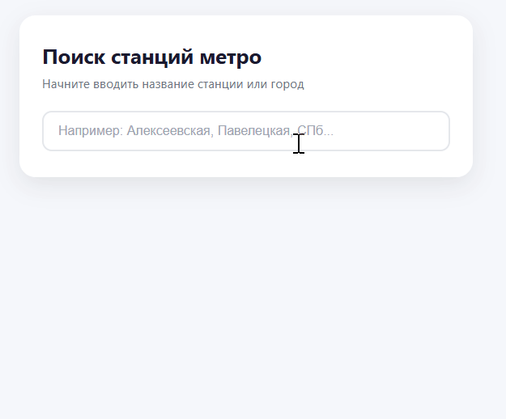

# Поиск станций метро

Домашнее задание к занятию 3.1 «Асинхронные запросы».

## Описание

Необходимо разработать приложение, которое выполняет поиск по станциям метро с подсказками при вводе и показывает подробную информацию о выбранной станции. Приложение должно отправлять асинхронные запросы к API подсказок DaData и корректно обрабатывать состояния загрузки, пустого результата и ошибки.

Приложение должно уметь:

- отправлять запрос на сервис подсказок при вводе пользователя в поле поиска;
- отображать список найденных станций метро с названием, городом и цветом линии;
- по клику на подсказку или клавише `Enter` показывать подробную информацию о выбранной станции;
- перемещаться по подсказкам стрелками `↑`/`↓` и закрывать список по `Escape` или клику вне его;
- обрабатывать состояния «загрузка», «ничего не найдено» и «ошибка запроса»;
- сбрасывать поиск и возвращаться к пустому состоянию, когда пользователь очищает поле ввода.



## Цель работы

На практике освоить:

- отправку асинхронных `POST`-запросов через `fetch`;
- передачу заголовков авторизации (`Authorization: Token <API_KEY>`);
- работу с дебаунсом ввода (чтобы не спамить API при каждом нажатии клавиши);
- отмену устаревших запросов через `AbortController`;
- навигацию по списку подсказок с клавиатуры;
- отрисовку списка результатов и подробной карточки в DOM.

## Используемое API

Все запросы отправляются на базовый URL **`https://suggestions.dadata.ru`**.

| Метод | Эндпоинт | Назначение |
|-------|----------|------------|
| `POST` | `/suggestions/api/4_1/rs/suggest/metro` | Получить подсказки по станциям метро |

### Документация

Официальная документация API: <https://dadata.ru/api/suggest/metro/>

### Формат запроса

```http
POST https://suggestions.dadata.ru/suggestions/api/4_1/rs/suggest/metro
Content-Type: application/json
Accept: application/json
Authorization: Token <API_KEY>
```

Тело запроса:

```json
{
  "query": "алек"
}
```

### Формат ответа

API возвращает объект вида:

```json
{
  "suggestions": [
    {
      "value": "г Москва, метро Алексеевская",
      "unrestricted_value": "г Москва, метро Алексеевская",
      "data": {
        "name": "Алексеевская",
        "city": "Москва",
        "line_id": "6",
        "line_name": "Калужско-Рижская",
        "color": "F58631",
        "geo_lat": "55.807897",
        "geo_lon": "37.639291",
        "is_closed": false,
        "type": "м."
      }
    }
  ]
}
```

Ключевые поля объекта `data`:

- `name` — название станции;
- `city` — город;
- `line_name` — название линии метро;
- `line_id` — номер линии;
- `color` — цвет линии в формате RGB (например, `"255,0,0"` или hex);
- `geo_lat`, `geo_lon` — координаты станции;
- `is_closed` — закрыта ли станция.

## Исходные данные

### HTML-разметка

Разметка и стили уже подготовлены в `index.html` и `task.css` — менять их не нужно. В `task.js` достаточно ссылаться на готовые элементы:

| Элемент | Назначение |
|---|---|
| `#metro-input` | поле поиска |
| `#suggestions` | список подсказок (`<ul>`) |
| `#spinner` | спиннер загрузки |
| `#error` | сообщение об ошибке |
| `#details` | карточка выбранной станции |
| `#details-title`, `#detail-city`, `#detail-line`, `#detail-coords`, `#detail-status` | поля карточки |

Показ и скрытие элементов управляется классом `visible` у `.spinner`, `.suggestions`, `.error` и `.details`.

## Процесс реализации

Разметка (`index.html`) и стили (`task.css`) уже готовы. В `task.js` подготовлен каркас:

- ссылки на элементы: `input` (`#metro-input`), `suggestionsEl` (`#suggestions`), `spinner` (`#spinner`), `errorEl` (`#error`), `detailsEl` (`#details`);
- переменные состояния: `debounceTimer` (таймер дебаунса) и `currentController` (текущий `AbortController`);
- `debounce(fn, delay)` — обёртка, которая откладывает вызов на `delay` мс;
- `showError(message)` — выводит сообщение в `#error` и скрывает его через 5 секунд;
- `hideSuggestions()` — снимает у списка класс `visible` и очищает его;
- `debouncedFetch` — вызов `fetchSuggestions` с задержкой 300 мс;
- пустые функции `fetchSuggestions`, `renderSuggestions`, `selectSuggestion`;
- пустые обработчики событий: `input` на поле ввода, `click` на `document`, `keydown` на поле ввода.

### 1. Обработка ввода — обработчик `input`

1. Взять значение поля: `e.target.value.trim()`.
2. Если оно пустое — вызвать `hideSuggestions()`, убрать класс `visible` у `detailsEl`, сбросить `suggestions` и не отправлять запрос.
3. Иначе передать значение в `debouncedFetch` — он вызовет `fetchSuggestions` после паузы 300 мс.

### 2. Запрос подсказок — `fetchSuggestions(query)`

1. Отменить предыдущий запрос, если он ещё не завершился (`if (currentController) currentController.abort();`), и создать новый `AbortController`, сохранив его в `currentController`.
2. Показать спиннер: `spinner.classList.add('visible')`.
3. Отправить запрос:

```js
fetch('https://suggestions.dadata.ru/suggestions/api/4_1/rs/suggest/metro', {
  method: 'POST',
  headers: {
    'Content-Type': 'application/json',
    Accept: 'application/json',
    Authorization: 'Token <API_KEY>'
  },
  body: JSON.stringify({ query }),
  signal: currentController.signal
});
```

4. Проверить `response.ok` — при `false` бросить ошибку.
5. Взять из ответа массив `suggestions` и передать его в `renderSuggestions(items)`.
6. Ошибку с именем `AbortError` игнорировать — это отменённый запрос, а не сбой; остальные показывать через `showError()`.
7. В `finally` снять со спиннера класс `visible`.

### 3. Отрисовка списка — `renderSuggestions(items)`

1. Сохранить массив в переменной списка (`suggestions = items`) и сбросить `activeIndex = -1`.
2. Очистить `suggestionsEl`.
3. Для каждой подсказки создать `<li>` с `role="option"` и `data-index` (индекс в массиве), внутри:
   - `<span class="line-dot">` — цвет линии: `style="background-color: #${item.data.color}"`;
   - `<span class="suggestion-text">` — `item.data.name`, внутри `<span class="city">` — `item.data.city`;
   - `<span class="closed-badge">закрыта</span>`, если `item.data.is_closed === true`.
4. Если массив пуст — вызвать `hideSuggestions()`, иначе добавить списку класс `visible`.

### 4. Выбор подсказки — `selectSuggestion(item)`

1. Записать `item.value` в `input`.
2. Вызвать `hideSuggestions()`.
3. Заполнить карточку станции (см. следующий шаг).

### 5. Карточка выбранной станции

Заполнить поля, которые уже есть в разметке, и показать карточку (`detailsEl.classList.add('visible')`):

| Элемент | Значение |
|---|---|
| `#details-title` | `item.data.name` |
| `#detail-city` | `item.data.city` |
| `#detail-line` | `item.data.line_name` и номер линии (`item.data.line_id`) |
| `#detail-coords` | `item.data.geo_lat`, `item.data.geo_lon` через запятую |
| `#detail-status` | `item.data.is_closed ? 'Закрыта' : 'Открыта'` |

Если поля в ответе нет — выводить `—`.

### 6. Клик на странице — обработчик `click` на `document`

Один обработчик на всё приложение:

1. Если клик пришёлся на строку списка (`e.target.closest('#suggestions li')`), взять индекс из `data-index`, достать объект из массива `suggestions` и вызвать `selectSuggestion(item)`.
2. Если клик был вне поля ввода и вне списка (`#suggestions`) — скрыть список через `hideSuggestions()`.

### 7. Клавиатура — обработчик `keydown` на поле ввода

1. `ArrowDown` / `ArrowUp` — перемещать активную строку: индекс хранится в `activeIndex`, у выбранного `<li>` добавляется класс `active` (стили для него уже есть в `task.css`), у предыдущего — снимается. По краям списка индекс не должен выходить за границы.
2. `Enter` — если активная строка есть, вызвать `selectSuggestion(suggestions[activeIndex])`.
3. `Escape` — скрыть список через `hideSuggestions()`.
4. Для стрелок и `Enter` вызывать `e.preventDefault()`, чтобы каретка не прыгала в поле и страница не прокручивалась.
5. Если список скрыт или пуст, клавиши ничего не делают.

### 8. Состояния загрузки и ошибки

- Пока идёт запрос — у спиннера класс `visible`.
- Пустой ответ — список скрыт (по желанию можно показать «Ничего не найдено»).
- `response.ok === false` или сетевая ошибка — сообщение через `showError()`, оно само исчезнет через 5 секунд.

## Примеры разметки

<details>
  <summary>Строка подсказки в списке</summary>

  ```html
  <li data-index="0" role="option">
    <span class="line-dot" style="background-color: #F58631;"></span>
    <span class="suggestion-text">
      Алексеевская
      <span class="city">Москва</span>
    </span>
    <span class="closed-badge">закрыта</span>
  </li>
  ```
</details>

<details>
  <summary>Карточка выбранной станции после заполнения</summary>

  ```html
  <div class="details visible" id="details">
    <h2 id="details-title">Алексеевская</h2>
    <div class="details-row">
      <span class="label">Город</span>
      <span class="value" id="detail-city">Москва</span>
    </div>
    <div class="details-row">
      <span class="label">Линия</span>
      <span class="value" id="detail-line">Калужско-Рижская (№6)</span>
    </div>
    <div class="details-row">
      <span class="label">Координаты</span>
      <span class="value" id="detail-coords">55.807897, 37.639291</span>
    </div>
    <div class="details-row">
      <span class="label">Статус</span>
      <span class="value" id="detail-status">Открыта</span>
    </div>
  </div>
  ```
</details>

## Решение задач

1. Перейти в папку задания. `cd ./async-requests/1_metro-station`.
2. Открыть файл `task.js` в вашем редакторе кода и выполнить задание.
3. Открыть файл `task.html` в вашем браузере и убедиться в правильности выводимых результатов.
4. Добавить файл `task.js` в индекс git с помощью команды `git add %file-path%`, где `%file-path%` — путь до целевого файла. `git add task.js`.
5. Сделать коммит используя команду `git commit -m '%comment%'`, где `%comment%` — это произвольный комментарий к вашему коммиту. `git commit -m 'first commit metro-station'`.
6. Опубликовать код в репозиторий homeworks с помощью команды `git push -u origin master`.
7. Прислать ссылку на репозиторий через личный кабинет на сайте Нетологии.

*Никаких файлов прикреплять не нужно.*

Все задачи обязательны к выполнению для получения зачета. Присылать на проверку можно каждую задачу по отдельности или все задачи вместе. Во время проверки по частям ваша домашняя работа будет со статусом "На доработке".

Любые вопросы по решению задач задавайте в чате учебной группы.