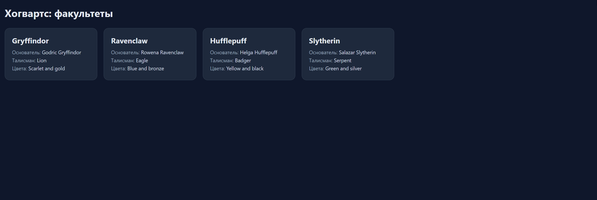

# Факультеты Хогвартса

Домашнее задание к занятию 3.1 «Асинхронные запросы».

## Описание

Необходимо разработать приложение, которое отображает список факультетов Хогвартса, и по клику показывает подробную информацию о выбранном факультете.



### Исходные данные

- Основная HTML-разметка

Для отображения списка факультетов используйте контейнер из разметки:

```html
<div class="grid" id="houses"></div>
```

Для отображения карточки выбранного факультета используйте контейнер:

```html
<div class="details hidden" id="house"></div>
```

## Процесс реализации

Разметка (`task.html`) и стили (`task.css`) уже готовы, менять их не нужно. В `task.js` подготовлен каркас:

- `API_BASE` — адрес API;
- ссылки на элементы: `statusEl` (`#status`), `listEl` (`#houses`), `detailsEl` (`#house`), `backBtn` (`#backBtn`);
- `setStatus(text, isError)` — показывает сообщение в `#status` и при `isError === true` добавляет класс `error`;
- `clearStatus()` — скрывает сообщение;
- `esc(str)` — экранирует HTML-спецсимволы; пропускайте через неё все значения из ответа API;
- пустые функции `loadHouses`, `renderHouses`, `loadHouseById`, `renderHouseDetails`;
- вызов `loadHouses()` в конце файла — с него начинается работа приложения.

1. **`loadHouses()`** — загрузка списка:
   - `setStatus('Загрузка…')`;
   - `fetch(`${API_BASE}/Houses`)`;
   - проверить `response.ok` (при `false` бросить ошибку);
   - передать полученный массив в `renderHouses(houses)` и вызвать `clearStatus()`;
   - в `catch` — `setStatus('Не удалось загрузить факультеты', true)`.

2. **`renderHouses(houses)`** — карточки в `listEl`:
   - для каждого факультета — `<article class="card" data-id="${esc(house.id)}">`;
   - внутри `<h2>` с `name` и строки `<p><span>Основатель:</span> …</p>` для `founder`, `animal` и `houseColours`;
   - пустое значение заменять на `—`;
   - собрать разметку строкой и один раз присвоить `listEl.innerHTML`.

3. **Клик по карточке.** На `listEl` добавить обработчик события `click` и через `event.target.closest('.card')` найти карточку, а по `card.dataset.id` — идентификатор. Затем вызвать `loadHouseById(id)`.

4. **`loadHouseById(id)`** — загрузка одного факультета:
   - `setStatus('Загрузка…')`;
   - `fetch(`${API_BASE}/Houses/${id}`)`;
   - проверить `response.ok`;
   - передать объект в `renderHouseDetails(house)` и вызвать `clearStatus()`;
   - при ошибке — `setStatus('Не удалось загрузить факультет', true)`.

5. **`renderHouseDetails(house)`** — карточка в `detailsEl`:
   - скрыть список: `listEl.classList.add('hidden')`;
   - вывести `<h2>` с `name` и строки `<div class="row"><div class="label">…</div><div class="value">…</div></div>` для `founder`, `animal`, `element`, `ghost`, `commonRoom` и `houseColours`;
   - `heads` — массив объектов: вывести через запятую имена деканов (`firstName` + `lastName`);
   - `traits` — массив строк: вывести через запятую;
   - убрать `hidden` у `detailsEl` и у `backBtn`.

6. **Возврат к списку.** По клику на `backBtn`: добавить `hidden` для `detailsEl`, убрать `hidden` у `listEl` и `backBtn`.

7. **Состояния.** Пока идёт запрос — «Загрузка…»; при ошибке — сообщение с классом `error` (второй аргумент `setStatus`); после успешной загрузки — `clearStatus()`.

<details>
  <summary>Пример разметки карточки списка факультета</summary>
  ```html
  <article class="card" data-id="0367baf3-1cb6-4baf-bede-48e17e1cd005">
    <h2>Gryffindor</h2>
    <p><span>Основатель:</span> Godric Gryffindor</p>
    <p><span>Талисман:</span> Lion</p>
    <p><span>Цвета:</span> Scarlet and gold</p>
  </article>
  ```
</details>

<details>
  <summary>Пример разметки карточки факультета</summary>
  ```html
  <div class="details" id="house">
    <h2>Hufflepuff</h2>
    <div class="row"><div class="label">Основатель</div><div class="value">Helga Hufflepuff</div></div>
    <div class="row"><div class="label">Талисман</div><div class="value">Badger</div></div>
    <div class="row"><div class="label">Стихия</div><div class="value">Earth</div></div>
    <div class="row"><div class="label">Призрак</div><div class="value">Fat Friar</div></div>
    <div class="row"><div class="label">Гостиная</div><div class="value">Hufflepuff Basement</div></div>
    <div class="row"><div class="label">Цвета</div><div class="value">Yellow and black</div></div>
    <div class="row"><div class="label">Декан(ы)</div><div class="value">Helga Hufflepuff, Pomona Sprout</div></div>
    <div class="row"><div class="label">Черты</div><div class="value">Hardworking, Patience, Loyalty, Just, Fairness, Modesty</div></div>
  </div>
  ```
</details>

## Решение задач

1. Перейти в папку задания. `cd ./async-requests/2_1_wizard-houses`.
2. Открыть файл `task.js` в вашем редакторе кода и выполнить задание.
3. Открыть файл `task.html` в вашем браузере и убедиться в правильности выводимых результатов.
4. Добавить файл `task.js` в индекс git с помощью команды `git add %file-path%`, где `%file-path%` — путь до целевого файла. `git add task.js`.
5. Сделать коммит используя команду `git commit -m '%comment%'`, где `%comment%` — это произвольный комментарий к вашему коммиту. `git commit -m 'first commit wizard-houses'`.
6. Опубликовать код в репозиторий homeworks с помощью команды `git push -u origin master`.
7. Прислать ссылку на репозиторий через личный кабинет на сайте Нетологии.

*Никаких файлов прикреплять не нужно.*

Все задачи обязательны к выполнению для получения зачета. Присылать на проверку можно каждую задачу по отдельности или все задачи вместе. Во время проверки по частям ваша домашняя работа будет со статусом "На доработке".

Любые вопросы по решению задач задавайте в чате учебной группы.