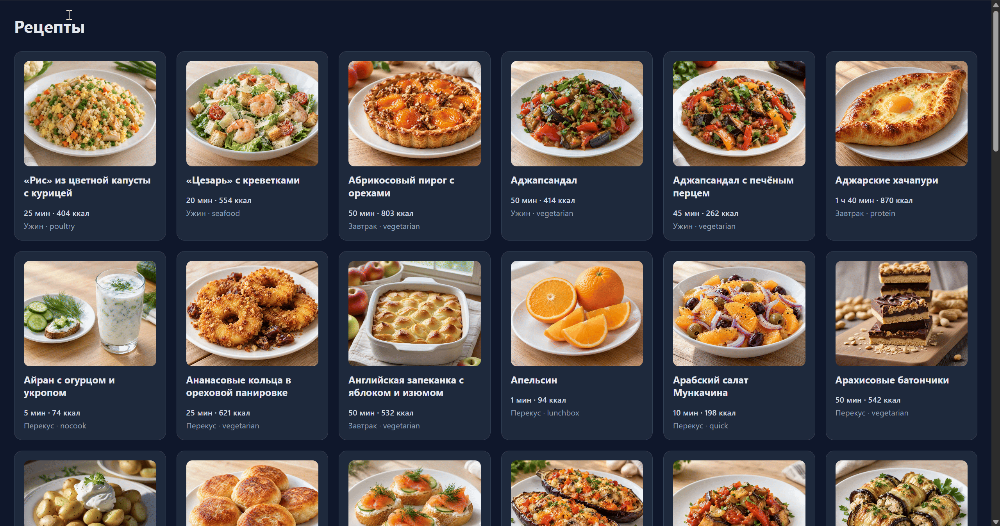

# Рецепты

Домашнее задание к занятию 3.1 «Асинхронные запросы».

## Описание

Необходимо разработать приложение, которое отображает список рецептов, и по клику показывает подробную информацию о выбранном рецепте.



### Исходные данные

- Основная HTML-разметка

Для отображения списка рецептов используйте контейнер из разметки:

```html
<div class="grid" id="list"></div>
```

Для отображения карточки выбранного рецепта используйте контейнер:

```html
<div class="details hidden" id="details"></div>
```

### Документация API

Все запросы отправляются на `https://racion.app`.

- Список рецептов: `GET https://racion.app/api/recipes`
- Один рецепт по идентификатору: `GET https://racion.app/api/recipes/{id}`

**Важно.** Эндпоинт списка возвращает не массив, а объект вида:

```json
{
  "items": [ /* массив рецептов */ ],
  "limit": 50,
  "offset": 0,
  "total": 2080
}
```

Сами рецепты находятся в поле `items`. Идентификатор рецепта лежит в поле `ID` (заглавными буквами, а не `id`).

## Процесс реализации

Разметка (`task.html`) и стили (`task.css`) уже готовы, менять их не нужно. В `task.js` подготовлен каркас:

- `API_BASE` — `https://racion.app`;
- ссылки на элементы: `statusEl` (`#status`), `listEl` (`#list`), `detailsEl` (`#details`), `backBtn` (`#backBtn`);
- `setStatus(text, isError)` и `clearStatus()` — те же помощники, что и в задании про факультеты;
- `esc(str)` — экранирование HTML;
- `imgUrl(path)` — собирает адрес картинки: абсолютный URL возвращает как есть, относительный путь дополняет `API_BASE`, а для пустого значения отдаёт заглушку `PLACEHOLDER`;
- пустые функции `loadRecipes`, `renderRecipes`, `loadRecipeById`, `renderRecipeDetails`;
- вызов `loadRecipes()` в конце файла — с него начинается работа приложения.

1. **`loadRecipes()`** — загрузка списка:
   - `setStatus('Загрузка…')`;
   - `fetch(`${API_BASE}/api/recipes`)`;
   - проверить `response.ok`;
   - взять из ответа поле **`items`** (ответ — объект `{ items, limit, offset, total }`, а не массив);
   - передать массив в `renderRecipes(items)` и вызвать `clearStatus()`;
   - при ошибке — `setStatus('Не удалось загрузить рецепты', true)`.

2. **`renderRecipes(recipes)`** — карточки в `listEl`:
   - `<article class="card" data-id="${esc(recipe.ID)}">` — идентификатор лежит в поле `ID` (заглавными буквами);
   - ``; если картинки нет, `imgUrl` вернёт заглушку — добавьте картинке класс `placeholder`;
   - `<h2>` с `Title`;
   - `<p class="meta">` с `TimeLabel` и `KcalLabel`;
   - `<p>` с `Slot_`;
   - пустые поля заменять на `—`, собрать разметку строкой и один раз присвоить `listEl.innerHTML`.

3. **Клик по карточке.** На `listEl` добавить обработчик `click`, найти карточку через `event.target.closest('.card')` и по `card.dataset.id` вызвать `loadRecipeById(id)`.

4. **`loadRecipeById(id)`** — загрузка одного рецепта:
   - `setStatus('Загрузка…')`;
   - `fetch(`${API_BASE}/api/recipes/${id}`)`;
   - проверить `response.ok`;
   - передать объект в `renderRecipeDetails(recipe)` и вызвать `clearStatus()`;
   - при ошибке — `setStatus('Не удалось загрузить рецепт', true)`.

5. **`renderRecipeDetails(recipe)`** — карточка в `detailsEl`:
   - скрыть сетку: `listEl.classList.add('hidden')`;
   - картинка `` (при заглушке — класс `placeholder`), заголовок `title` и описание `description`;
   - заметки из `notes.ru` — блок `.note` со строками `.note-row` для `why`, `swaps`, `mistakes`, `keep` и `serve`; отсутствующие заметки не выводить;
   - шаги из `steps` — список `<ol>` с `<li>` для каждого шага;
   - убрать `hidden` у `detailsEl` и у `backBtn`.

6. **Возврат к списку.** По клику на `backBtn`: скрыть `detailsEl`, показать `listEl`, скрыть `backBtn`.

7. **Состояния.** «Загрузка…», ошибки и очистка — через `setStatus` и `clearStatus`; все значения из ответа вставлять через `esc()`.

<details>
  <summary>Пример разметки карточки списка рецептов</summary>
  ```html
  <article class="card" data-id="abrikosovyy_pirog">
    
    <h2>Абрикосовый пирог с орехами</h2>
    <p class="meta">50 мин · 803 ккал</p>
    <p>Завтрак · vegetarian</p>
  </article>
  ```
</details>

<details>
  <summary>Пример разметки карточки рецепта</summary>
  ```html
  <section id="details" class="details">
    
    <h2>Аджапсандал</h2>
    <p class="desc">Грузинское овощное рагу из баклажанов, перца, помидоров и зелени, подаётся с лавашем.</p>
    <div class="note">
      <h4>Заметки</h4>
      <div class="note-row"><span class="note-label">Почему:</span>Соли баклажаны, ....</div>
      <div class="note-row"><span class="note-label">Замены:</span>За болгарский перец ...</div>
      <div class="note-row"><span class="note-label">Ошибки:</span>Если баклажаны не обжаривать ...</div>
      <div class="note-row"><span class="note-label">Хранение:</span>Храни в холодильнике ...</div>
      <div class="note-row"><span class="note-label">Подача:</span>Подавай с лавашем ...</div>
    </div>
    <h3 class="section-title">Шаги приготовления</h3>
    <ol class="steps">
      <li>Баклажаны нарезать ...</li>
      <li>На сковороде ...</li>
      <li>Лук нарезать ...</li>
      <li>Помидоры нарезать ...</li>
      <li>Вернуть баклажаны ...</li>
      <li>Снять с огня ...</li>
    </ol>
  </section>
  ```
</details>

## Решение задач

1. Перейти в папку задания. `cd ./async-requests/2_2_racion-recipes`.
2. Открыть файл `task.js` в вашем редакторе кода и выполнить задание.
3. Открыть файл `task.html` в вашем браузере и убедиться в правильности выводимых результатов.
4. Добавить файл `task.js` в индекс git с помощью команды `git add %file-path%`, где `%file-path%` — путь до целевого файла. `git add task.js`.
5. Сделать коммит используя команду `git commit -m '%comment%'`, где `%comment%` — это произвольный комментарий к вашему коммиту. `git commit -m 'first commit racion-recipes'`.
6. Опубликовать код в репозиторий homeworks с помощью команды `git push -u origin master`.
7. Прислать ссылку на репозиторий через личный кабинет на сайте Нетологии.

*Никаких файлов прикреплять не нужно.*

Все задачи обязательны к выполнению для получения зачета. Присылать на проверку можно каждую задачу по отдельности или все задачи вместе. Во время проверки по частям ваша домашняя работа будет со статусом "На доработке".

Любые вопросы по решению задач задавайте в чате учебной группы.