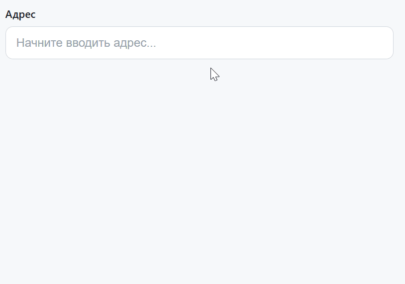

# Автодополнение адреса

Домашнее задание к занятию 3.1 «Асинхронные запросы».

## Описание

Необходимо реализовать поле ввода с автодополнением адреса. Пользователь начинает вводить адрес — после ввода отправляется запрос к API подсказок, и под полем появляется список подходящих вариантов. При выборе одного из вариантов значение подставляется в поле, и запрос повторяется — можно уточнить адрес до квартиры или офиса.



### Исходные данные

- Основная HTML-разметка (см. ниже)
- Базовая CSS-разметка (см. ниже)
- API: **DaData Suggestions** (`https://suggestions.dadata.ru/suggestions/api/4_1/rs/suggest/address`)

## API

### Эндпоинт

```
POST https://suggestions.dadata.ru/suggestions/api/4_1/rs/suggest/address
```

### Заголовки

| Заголовок | Значение |
|---|---|
| `Content-Type` | `application/json` |
| `Accept` | `application/json` |
| `Authorization` | `Token API_КЛЮЧ` |

### Тело запроса
     
```json
{
  "query": "москва лен",
  "count": 8,
  "locations": [{ "country": "Россия" }]
}
```

- `query` — строка, которую ввёл пользователь (обязательное поле);
- `count` — максимальное количество подсказок (необязательно, по умолчанию 10);
- `locations` — фильтр по стране (необязательно).

### Формат ответа

```json
{
  "suggestions": [
    {
      "value": "г Москва, пр-кт Ленинградский",
      "unrestricted_value": "г Москва, пр-кт Ленинградский",
      "data": {
        "postal_code": "125167",
        "region_with_type": "г Москва",
        "city_with_type": "г Москва",
        "fias_id": "0c5b2444-70a0-4932-980c-b4dc0d3f02b5",
        "kladr_id": "7700000000000",
        "geo_lat": "55.792083",
        "geo_lon": "37.560633"
      }
    }
  ]
}
```

Для решения достаточно использовать следующие поля:

- `suggestions[].value` — полная строка адреса для подстановки в поле ввода;
- `suggestions[].data.postal_code` — почтовый индекс;
- `suggestions[].data.region_with_type` — регион;
- `suggestions[].data.city_with_type` — город;
- `suggestions[].data.fias_id` — идентификатор ФИАС;
- `suggestions[].data.kladr_id` — идентификатор КЛАДР;
- `suggestions[].data.geo_lat` и `suggestions[].data.geo_lon` — координаты.

## Разметка для результирующего списка

Список подсказок формируется динамически внутри элемента `#suggestions`.

### Шаблон одного элемента

```html
<li
  class="autocomplete__item"
  id="suggestion-0"
  role="option"
  aria-selected="false"
  data-index="0"
>
  <span>г Москва, <mark>лен</mark>инградский пр-кт</span>
  <span class="autocomplete__meta">125167, г Москва, г Москва</span>
</li>
```

- `#suggestions` — контейнер списка (`.autocomplete__list`);
- каждый элемент списка — `<li class="autocomplete__item">`;
- внутри `<li>` первая `<span>` содержит значение адреса, совпавшая часть обёрнута в `<mark>`;
- вторая `<span class="autocomplete__meta">` содержит дополнительную информацию (индекс, регион, город);
- атрибут `data-index` хранит индекс элемента в массиве подсказок.

При выборе элемента вызывается функция `selectSuggestion(index)`, которая:
1. подставляет `value` в поле ввода;
2. очищает список;
3. выводит подробные данные в блок `#result`.

## Процесс реализации

Разметка (`task.html`) и стили (`task.css`) уже готовы. В `task.js` подготовлен каркас:

- `CONFIG` — адрес эндпоинта, `count` (сколько подсказок запрашивать), `debounceMs` (задержка дебаунса, 250 мс) и `minLength` (минимальная длина запроса, 2 символа);
- ссылки на элементы: `input` (`#address`), `listEl` (`#suggestions`), `spinner` (`.autocomplete__spinner`), `resultEl` (`#result`);
- состояние приложения: `suggestions` (текущий массив подсказок), `activeIndex` (индекс активной строки), `abortCtrl` (текущий `AbortController`), `debounceId` (идентификатор таймера дебаунса);
- `escapeHtml(str)` — экранирование HTML;
- `highlight(text, query)` — оборачивает совпавшую с запросом часть строки в `<mark>`;
- `handleInput()` и навешенный на `input` обработчик события `input`.

Дописать нужно функции `fetchAndRender`, `requestSuggestions`, `renderList`, `closeList`, `setActive`, `selectSuggestion` и обработчик клика по списку.

1. **`fetchAndRender(query, immediate = false)`** — общая точка входа для запроса:
   - если `query.length < CONFIG.minLength` — сбросить таймер (`clearTimeout(debounceId)`), отменить активный запрос, вызвать `closeList()`, очистить `resultEl` и выйти;
   - если `immediate === true` — сразу вызвать `requestSuggestions(query)`;
   - иначе сбросить предыдущий таймер и запланировать запрос: `debounceId = setTimeout(() => requestSuggestions(query), CONFIG.debounceMs)`.

2. **`requestSuggestions(query)`** — сам запрос:
   - отменить предыдущий запрос (`if (abortCtrl) abortCtrl.abort()`) и создать новый `AbortController`, сохранив его в `abortCtrl`, — так устаревший ответ не перетрёт свежий;
   - показать спиннер: `spinner.classList.add('is-visible')`;
   - отправить `POST` на `CONFIG.url` с заголовками `Content-Type`, `Accept` и `Authorization: 'Token ' + token`, телом `{ query, count: CONFIG.count }` и `signal: abortCtrl.signal`; токен в каркасе не задан — объявите его сами (например, `const token = '<ваш ключ DaData>';`);
   - проверить `response.ok`;
   - обновить `suggestions = data.suggestions ?? []` и передать массив в `renderList(suggestions, query)`;
   - ошибку с `err.name === 'AbortError'` игнорировать, остальные — вывести текст в `resultEl`;
   - в `finally` снять со спиннера класс `is-visible`.

3. **`renderList(items, query)`**:
   - очистить `listEl`; если `items` пуст — вызвать `closeList()` и выйти;
   - для каждой подсказки создать `<li class="autocomplete__item" id="suggestion-N" role="option" aria-selected="false" data-index="N">` (шаблон есть в разделе «Разметка для результирующего списка»);
   - первая `<span>` — `highlight(item.value, query)`;
   - вторая `<span class="autocomplete__meta">` — мета-информация: индекс, регион и город (`data.postal_code`, `data.region_with_type`, `data.city_with_type`);
   - показать список (`listEl.hidden = false`) и сбросить `activeIndex = -1`.

4. **`closeList()`** — `listEl.hidden = true`, очистить `listEl.innerHTML`, `activeIndex = -1`.

5. **`setActive(index)`**:
   - снять у предыдущего элемента класс `is-active` и вернуть `aria-selected="false"`;
   - у элемента `listEl.children[index]` добавить `is-active` и `aria-selected="true"`;
   - запомнить `activeIndex = index` и прокрутить элемент в видимую область (`scrollIntoView({ block: 'nearest' })`).

6. **`selectSuggestion(index)`** — взять `const item = suggestions[index];` и:
   - записать `item.value` в поле ввода;
   - закрыть список: `closeList()`;
   - вывести в `resultEl` подробные данные подсказки: `value`, индекс (`item.data.postal_code`), регион (`item.data.region_with_type`), город (`item.data.city_with_type`), ФИАС (`item.data.fias_id`), КЛАДР (`item.data.kladr_id`) и координаты (`item.data.geo_lat`, `item.data.geo_lon`); текст пропускать через `escapeHtml`;
   - программная запись в `input` не вызывает событие `input`, поэтому список не откроется снова; следующий запрос уйдёт, когда пользователь продолжит ввод, — так адрес можно уточнить до дома или квартиры.

7. **Клик по подсказке.** На `listEl` добавить обработчик `click`, найти `event.target.closest('.autocomplete__item')` и вызвать `selectSuggestion(Number(item.dataset.index))`.

## Повышенный уровень сложности (не обязательно)

Дебаунс (`CONFIG.debounceMs`) и подсветка совпадений (`highlight()`) уже есть в каркасе, поэтому дополнительно можно сделать:

* управление клавиатурой:
  * `Escape`, `Tab` — закрывают список;
  * `ArrowDown` / `ArrowUp` — перемещение по списку через `setActive()`;
  * `Enter` — выбор подсказки через `selectSuggestion(activeIndex)`;
* подсветку строки под курсором мыши — тоже через `setActive()`.

## Решение задач

1. Перейдите в папку задания:
   ```
   cd ./async-requests/3_address-autocomplete
   ```
2. Откройте файл `task.js` в вашем редакторе кода и выполните задание.
3. Откройте файл `task.html` в вашем браузере и убедитесь в правильности выводимых результатов.
4. Добавьте файл `task.js` в индекс git:
   ```
   git add task.js
   ```
5. Сделайте коммит:
   ```
   git commit -m 'first commit address-autocomplete'
   ```
6. Опубликуйте код в репозиторий `homeworks`:
   ```
   git push -u origin master
   ```
7. Пришлите ссылку на репозиторий через личный кабинет на сайте [Нетологии](https://netology.ru/).

*Никаких файлов прикреплять не нужно.*

Все задачи обязательны к выполнению для получения зачета. Присылать на проверку можно каждую задачу по отдельности или все задачи вместе. Во время проверки по частям ваша домашняя работа будет со статусом "На доработке".

Любые вопросы по решению задач задавайте в чате учебной группы.