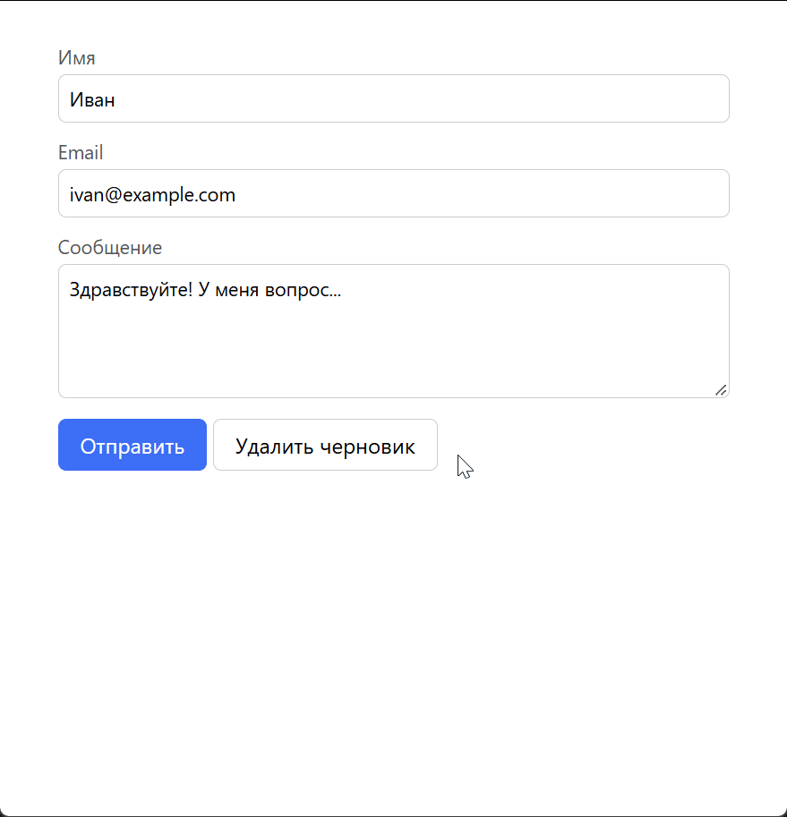

# Автосохранение черновика формы

Домашнее задание к занятию 3.2 «Хранение состояния на клиенте».

## Описание

Необходимо реализовать форму обратной связи с автосохранением черновика в `localStorage`. Пользователь начинает заполнять форму — введённые значения через короткую задержку автоматически сохраняются в браузере. Если пользователь обновит страницу или закроет и снова откроет вкладку, форма восстанавливается с последними данными, а над ней появляется уведомление о восстановлении. После успешной отправки черновик удаляется.



### Исходные данные

- Основная HTML-разметка (см. ниже)
- Базовая CSS-разметка (см. ниже)
- API браузера: **Web Storage** (`localStorage`)

## Хранилище

### Ключ

```
feedbackForm:draft
```

### Формат значения

Значение — JSON-строка с объектом черновика:

```json
{
  "name": "Иван",
  "email": "ivan@example.com",
  "message": "Здравствуйте! У меня вопрос...",
  "savedAt": "YYYY-MM-DDThh:mm:ss"
}
```

Для решения достаточно использовать следующие поля:

- `name` — значение поля «Имя»;
- `email` — значение поля «Email»;
- `message` — значение поля «Сообщение»;
- `savedAt` — ISO-строка с датой и временем сохранения (необязательно).

### Методы `localStorage`

| Метод | Назначение |
|---|---|
| `localStorage.setItem(key, value)` | сохранить JSON-строку черновика |
| `localStorage.getItem(key)` | получить строку черновика (или `null`) |
| `localStorage.removeItem(key)` | удалить черновик |

## Разметка формы

```html
<main class="card">
  <div id="status"></div>

  <form id="form">
    <label>Имя <input name="name" required></label>
    <label>Email <input name="email" type="email" required></label>
    <label>Сообщение <textarea name="message" required></textarea></label>

    <button type="submit">Отправить</button>
    <button type="button" id="clear">Удалить черновик</button>
  </form>

  <pre id="out"></pre>
</main>
```

- `#form` — форма, все поля доступны через `form.elements`;
- `#status` — блок для уведомлений (восстановлен черновик, отправлено, удалено);
- `#out` — блок для вывода отправленных данных.

## Процесс реализации

Разметка (`index.html`) и стили (`task.css`) уже готовы. В `task.js` подготовлен каркас:

- `KEY` — ключ черновика (`feedbackForm:draft`);
- ссылки на элементы: `formEl` (`#form`), `statusEl` (`#status`), `outEl` (`#out`);
- `showStatus(text)` — выводит текст в `#status` и показывает блок (по умолчанию он скрыт стилями);
- `getData()` — возвращает объект `{ name, email, message }` с текущими значениями полей;
- `timer` и `saveDebounced()` — дебаунс на 500 мс: сбрасывает предыдущий таймер и вызывает `save()`;
- пустая функция `save()`;
- пустые обработчики: `input` на форме, `submit` на форме и `click` на кнопке `#clear`;
- комментарий `// TODO: Восстановление при загрузке` — на его месте нужно добавить код восстановления.

1. **`save()`** — сохранение черновика:
   - возьмите данные через `getData()` и проверьте, есть ли хотя бы одно непустое значение (`Object.values(data).some(Boolean)`);
   - если все поля пустые — удалите ключ: `localStorage.removeItem(KEY)`;
   - иначе сохраните `localStorage.setItem(KEY, JSON.stringify({ ...data, savedAt: new Date().toISOString() }))`;
   - оберните работу с хранилищем в `try/catch`: в приватном режиме или при переполнении запись может выбросить исключение — покажите `showStatus('Не удалось сохранить черновик')`.

2. **Ввод в форму — обработчик `input`.** Проверьте, что в нём вызывается `saveDebounced()`: пока пользователь печатает, таймер перезапускается, а запись в `localStorage` происходит только после паузы 500 мс.

3. **Отправка формы — обработчик `submit`**:
   - вызовите `e.preventDefault()`, чтобы страница не перезагружалась;
   - у полей в разметке стоит `required`, поэтому браузер сам не даст отправить невалидную форму — `submit` срабатывает только при заполненных полях;
   - получите данные через `getData()` и выведите их в `outEl`: `outEl.textContent = JSON.stringify(data, null, 2)` и `outEl.style.display = 'block'`;
   - удалите черновик из `localStorage` и очистите форму через `formEl.reset()`;
   - покажите `showStatus('Данные отправлены, черновик удалён')`.

4. **Кнопка «Удалить черновик» — обработчик `click` на `#clear`**:
   - `localStorage.removeItem(KEY)` (в `try/catch`);
   - `formEl.reset()` и очистка `outEl` (`textContent = ''`, `style.display = 'none'`);
   - `showStatus('Черновик удалён')`.

5. **Восстановление при загрузке** — вместо комментария `// TODO`:
   - `const raw = localStorage.getItem(KEY)`; если `raw === null` — ничего не делать;
   - разберите строку через `JSON.parse` в `try/catch`: при ошибке удалите ключ (`localStorage.removeItem(KEY)`) и оставьте форму пустой;
   - подставьте значения в поля: `formEl.elements.name.value = data.name ?? ''` и так же для `email` и `message`;
   - покажите `showStatus(...)`; если в черновике есть `savedAt`, добавьте к сообщению дату: `new Date(data.savedAt).toLocaleString('ru-RU')`.
   - код восстановления выполняется сразу при загрузке скрипта — он подключён в конце `index.html`, поэтому форма к этому моменту уже есть в DOM.

### Обработка ошибок

- Все обращения к `localStorage` обёрните в `try/catch`: в приватном режиме браузера или при переполнении хранилища запись может выбросить исключение `QuotaExceededError`. Покажите пользователю уведомление об ошибке, не «роняя» интерфейс.
- `JSON.parse` тоже может выбросить исключение, если в хранилище окажется повреждённая строка — обработайте и удалите некорректный ключ.

## Повышенный уровень сложности (не обязательно)

* Сохраняйте в черновик `savedAt` (ISO-строка через `new Date().toISOString()`) и при восстановлении показывайте в уведомлении дату сохранения в человекочитаемом виде (`toLocaleString('ru-RU')`).
* Добавьте сохранение при `beforeunload` — на случай, если пользователь закроет вкладку раньше, чем сработает debounce.
* Введите ограничение срока жизни черновика: если `savedAt` старше 7 дней — удаляйте черновик при восстановлении.
* Синхронизируйте вкладки через событие `storage`: если пользователь изменил черновик в одной вкладке, в другой это изменение тоже должно быть видно.
* Добавьте индикатор «Сохранено в HH:MM:SS» рядом с кнопками.

## Решение задач

1. Перейдите в папку задания:
   ```
   cd ./client-state/1_form-autosave
   ```
2. Откройте файл `task.js` в вашем редакторе кода и выполните задание.
3. Откройте файл `task.html` в вашем браузере и убедитесь в правильности выводимых результатов. Проверьте:
   - обновление страницы — поля сохраняются;
   - закрытие и повторное открытие вкладки — черновик на месте;
   - отправка формы — черновик удаляется;
   - кнопка «Удалить черновик» — форма и хранилище очищаются.
4. Добавьте файл `task.js` в индекс git:
   ```
   git add task.js
   ```
5. Сделайте коммит:
   ```
   git commit -m 'first commit form-autosave'
   ```
6. Опубликуйте код в репозиторий `homeworks`:
   ```
   git push -u origin master
   ```
7. Пришлите ссылку на репозиторий через личный кабинет на сайте [Нетологии](https://netology.ru/).

*Никаких файлов прикреплять не нужно.*

Все задачи обязательны к выполнению для получения зачета. Присылать на проверку можно каждую задачу по отдельности или все задачи вместе. Во время проверки по частям ваша домашняя работа будет со статусом "На доработке".

Любые вопросы по решению задач задавайте в чате учебной группы.