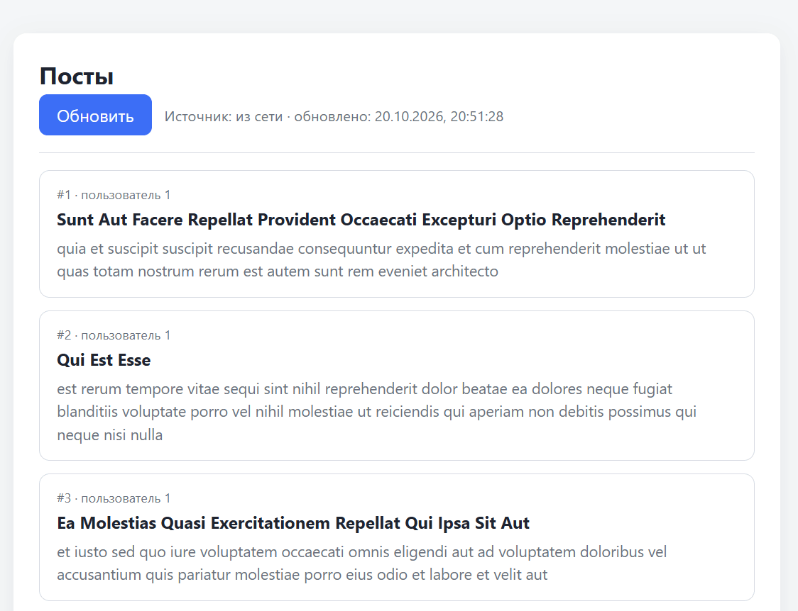

# Кэширование данных с Cache API

Домашнее задание к занятию 3.2 «Хранение состояния на клиенте».

## Описание

Необходимо реализовать страницу, которая загружает данные с публичного API и кэширует их в браузере. При первом открытии данные запрашиваются из сети и сохраняются в кэш. При повторном открытии — отдаются из кэша мгновенно, без обращения к сети. Отдельная кнопка «Обновить» принудительно загружает свежие данные, минуя кэш, и обновляет сохранённую копию. Если сеть недоступна, но в кэше есть данные — они показываются пользователю с предупреждением.



### Исходные данные

- Основная HTML-разметка (см. ниже)
- Базовая CSS-разметка (см. ниже)
- API: **JSONPlaceholder** (`https://jsonplaceholder.typicode.com/posts`)
- API браузера: **Cache API** (`caches`), опционально — `localStorage` как fallback

> **Важно:** Cache API доступен только на `https://` и `http://localhost`. При открытии страницы через `file://` объект `window.caches` может быть `undefined`. В решении предусмотрен fallback на `localStorage`, чтобы страница оставалась рабочей в любом окружении.

## API

### Эндпоинт

```
GET https://jsonplaceholder.typicode.com/posts?_limit=10
```

### Формат ответа

```json
[
  {
    "userId": 1,
    "id": 1,
    "title": "sunt aut facere repellat provident occaecati excepturi optio reprehenderit",
    "body": "quia et suscipit\nsuscipit recusandae consequuntur expedita et cum..."
  }
]
```

Для решения достаточно использовать следующие поля:

- `id` — идентификатор поста;
- `userId` — идентификатор автора;
- `title` — заголовок;
- `body` — текст поста.

## Cache API

### Методы

| Метод | Назначение |
|---|---|
| `caches.open(name)` | открыть (или создать) кэш с заданным именем |
| `cache.match(url)` | найти ответ по URL; возвращает `Response` или `undefined` |
| `cache.put(url, response)` | сохранить ответ в кэш по указанному URL |
| `caches.delete(name)` | полностью удалить кэш по имени |

### Имя кэша

```
posts-v1
```

Суффикс `-v1` — версия кэша. При изменении формата хранения или набора данных версию удобно поднять, чтобы старые записи не мешали.

### Формат сохранения

В кэш кладётся синтетический `Response` с сериализованными данными и временем сохранения в кастомном заголовке:

```js
const response = new Response(JSON.stringify(data), {
  headers: {
    'Content-Type': 'application/json',
    'X-Cached-At': new Date().toISOString()
  }
});
await cache.put(API_URL, response);
```

При чтении `cache.match(API_URL)` возвращает этот `Response` — из него извлекаются и данные (`await res.json()`), и время сохранения (`res.headers.get('X-Cached-At')`). Одна запись в кэше — и данные, и метаданные.

### Fallback на `localStorage`

Если `'caches' in window` возвращает `false`, используется `localStorage`:

```js
localStorage.setItem('posts:cache', JSON.stringify({ data, savedAt }));
```

## Разметка

```html
<main class="card">
  <h1>Посты</h1>

  <div class="toolbar">
    <button id="refresh" type="button">Обновить</button>
    <span id="status" class="status"></span>
  </div>

  <div id="error" class="error" hidden></div>
  <div id="loading" class="loading" hidden>Загрузка…</div>
  <div id="posts" class="posts"></div>
</main>
```

- `#refresh` — кнопка принудительного обновления;
- `#status` — строка с текущим источником данных («из кэша» / «из сети») и временем последнего обновления;
- `#error` — плашка с ошибкой (сеть недоступна, HTTP-ошибка);
- `#loading` — индикатор загрузки, показывается на время запроса;
- `#posts` — контейнер для карточек постов.

### Шаблон карточки поста

```html
<article class="post">
  <div class="post__meta">#1 · пользователь 1</div>
  <h2 class="post__title">sunt aut facere repellat...</h2>
  <p class="post__body">quia et suscipit...</p>
</article>
```

## Процесс реализации

Разметка (`task.html`) и стили (`task.css`) уже готовы. В `task.js` подготовлен каркас:

- константы: `CACHE_NAME` (`posts-v1`), `API_URL` (адрес JSONPlaceholder), `LS_KEY` (`posts:cache`) и `supportsCache` (`'caches' in window`);
- ссылки на элементы: `postsEl` (`#posts`), `statusEl` (`#status`), `errorEl` (`#error`), `loadingEl` (`#loading`), `refreshBtn` (`#refresh`);
- `busy` — флаг активного запроса;
- `formatDate(iso)` — форматирует дату через `toLocaleString('ru-RU')`, для пустого значения возвращает `—`;
- `showLoading(on)` — показывает `#loading`, блокирует кнопку `#refresh` и выставляет `busy`;
- `showError(msg)` — выводит текст в `#error` и показывает плашку (вызов `showError('')` её скрывает);
- `setStatus(savedAt, source)` — пишет в `#status` строку «Источник: из сети/из кэша · обновлено: …»;
- пустые функции `readCache()`, `writeCache(data)`, `render(posts)`, `load({ forceRefresh = false } = {})`;
- пустой обработчик клика по `#refresh`.

1. **`readCache()`** — чтение сохранённой копии, возвращает `{ data, savedAt }` или `null`:
   - если `supportsCache` — `const cache = await caches.open(CACHE_NAME)`, `const res = await cache.match(API_URL)`; записи нет — вернуть `null`, иначе `{ data: await res.json(), savedAt: res.headers.get('X-Cached-At') }`;
   - иначе — `localStorage.getItem(LS_KEY)` и `JSON.parse`; если записи нет или JSON битый — удалите ключ и верните `null`;
   - исключения хранилища перехватывайте (`try/catch`) и тоже возвращайте `null`: страница должна продолжить работу с сетью.

2. **`writeCache(data)`** — сохранение свежих данных, возвращает время сохранения:
   - если `supportsCache` — соберите `new Response(JSON.stringify(data), { headers: { 'Content-Type': 'application/json', 'X-Cached-At': savedAt } })` и положите через `cache.put(API_URL, response)`;
   - иначе — `localStorage.setItem(LS_KEY, JSON.stringify({ data, savedAt }))`;
   - `savedAt` — `new Date().toISOString()`; верните его, чтобы передать в `setStatus`.

3. **`render(posts)`** — отрисовка списка:
   - очистите `postsEl` (`innerHTML = ''`);
   - для каждого поста создайте `article.post`, внутри — `div.post__meta` (например, `#${post.id} · пользователь ${post.userId}`), `h2.post__title` и `p.post__body`;
   - текст вставляйте через `textContent`: данные приходят из сети, это защита от XSS.

4. **`load({ forceRefresh = false } = {})`** — основной сценарий:
   - в начале `showError('')` и `showLoading(true)`;
   - объявите `let cached = null;` и, если `forceRefresh === false`, прочитайте кэш: `cached = await readCache()`;
   - если запись есть — `render(cached.data)`, `setStatus(cached.savedAt, 'cache')` и выйдите, не обращаясь к сети;
   - иначе выполните `fetch(API_URL, { cache: 'no-store' })`, проверьте `response.ok` и получите `const data = await response.json()`;
   - сохраните данные (`const savedAt = await writeCache(data)`), отрисуйте их и вызовите `setStatus(savedAt, 'network')`;
   - в `catch`: если `cached` есть — покажите его (`render(cached.data)` + `setStatus(cached.savedAt, 'cache')`) и предупреждение `showError('Нет связи — показаны сохранённые данные')`; если кэша нет — только сообщение об ошибке;
   - в `finally` — `showLoading(false)`.

5. **Обновление — обработчик клика по `#refresh`.** Вызовите `load({ forceRefresh: true })`. Дополнительно можно проверять `busy`, чтобы не запускать второй запрос.

6. **Старт.** В конце файла вызовите `load()`: при первом открытии кэш пуст и данные придут из сети, при повторном — из кэша.

### Обработка ошибок

- Оберните обращения к Cache API и `localStorage` в `try/catch`: в приватном режиме или при переполнении хранилища они могут выбросить исключение. Ошибка чтения кэша не должна ломать страницу — просто переходите к сетевому запросу.
- `JSON.parse` может упасть, если в `localStorage` окажется повреждённая строка — обработайте и удалите некорректный ключ.
- Если сетевой запрос вернул не-2xx статус, не пытайтесь парсить ответ как JSON — сформируйте понятное сообщение об ошибке (`HTTP 500` и т.п.).

## Повышенный уровень сложности (не обязательно)

* Добавьте кнопку «Очистить кэш» — `caches.delete(CACHE_NAME)` (и `localStorage.removeItem(LS_KEY)` для fallback), после чего перезагрузите данные из сети.
* Введите срок жизни кэша (TTL): при чтении сравнивайте `savedAt` с текущим временем, и если запись старше, скажем, одного часа — автоматически уходите в сеть, даже без нажатия «Обновить».
* Реализуйте стратегию **stale-while-revalidate**: мгновенно отдайте данные из кэша, а параллельно (без блокировки UI) запустите сетевой запрос и, если данные изменились, перерисуйте список и обновите кэш.
* Добавьте выбор эндпоинта (посты / комментарии / пользователи) с сохранением каждого URL под своим ключом в одном кэше.
* Реализуйте префетч: при наведении на кнопку «Обновить» заранее начинайте загрузку данных.

## Решение задач

1. Перейдите в папку задания:
   ```
   cd ./client-state/2_cache-storage
   ```
2. Откройте файл `task.js` в вашем редакторе кода и выполните задание.
3. Откройте файл `task.html` в вашем браузере (рекомендуется через локальный сервер, например `npx serve` или `python -m http.server`) и убедитесь в правильности выводимых результатов. Проверьте:
   - первая загрузка — данные приходят из сети, статус «из сети»;
   - обновление страницы — данные приходят из кэша, время сохранения не меняется;
   - кнопка «Обновить» — данные загружаются из сети, время обновляется;
   - DevTools → Application → Cache Storage → `posts-v1` — там лежит сохранённый `Response`;
   - DevTools → Network → Offline + «Обновить» — появляется предупреждение, но кэшированные данные отображаются.
4. Добавьте файл `task.js` в индекс git:
   ```
   git add task.js
   ```
5. Сделайте коммит:
   ```
   git commit -m 'first commit cache-storage'
   ```
6. Опубликуйте код в репозиторий `homeworks`:
   ```
   git push -u origin master
   ```
7. Пришлите ссылку на репозиторий через личный кабинет на сайте [Нетологии](https://netology.ru/).

*Никаких файлов прикреплять не нужно.*

Все задачи обязательны к выполнению для получения зачета. Присылать на проверку можно каждую задачу по отдельности или все задачи вместе. Во время проверки по частям ваша домашняя работа будет со статусом "На доработке".

Любые вопросы по решению задач задавайте в чате учебной группы.