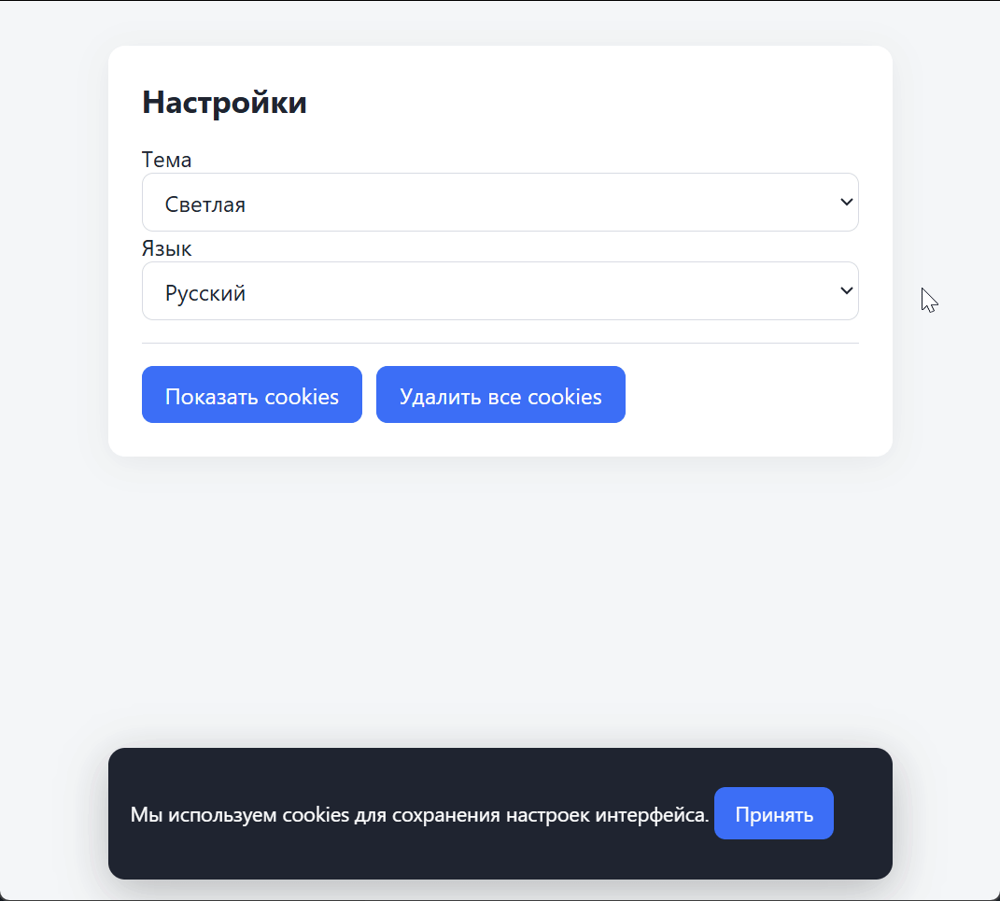

# Хранение пользовательских настроек в cookies

Домашнее задание к занятию 3.2 «Хранение состояния на клиенте».

## Описание

Необходимо реализовать страницу с баннером cookie-согласия и панелью пользовательских настроек, которые сохраняются в cookies. При первом посещении пользователь видит баннер с просьбой разрешить cookies. После согласия баннер больше не показывается (до истечения срока cookie). В настройках пользователь выбирает тему оформления и язык интерфейса — эти параметры тоже сохраняются в cookies и применяются при каждой загрузке страницы. Отдельная кнопка позволяет просмотреть все установленные cookies и удалить их.



### Исходные данные

- Основная HTML-разметка (см. ниже)
- Базовая CSS-разметка (см. ниже)
- API браузера: **`document.cookie`**

> **Важно:** при открытии страницы напрямую через `file://` (двойным кликом по `task.html`) cookies в большинстве браузеров **не работают**:
> - Chrome и Chromium-браузеры вообще не сохраняют cookies для `file://` — `document.cookie` всегда возвращает пустую строку;
> - Firefox может сохранять cookies для локальных файлов;
> - Safari блокирует cookies для локальных файлов.
>
> Поэтому для проверки задания запускайте страницу через локальный HTTP-сервер или браузер Firefox.

## Работа с cookies

### Чтение

```js
const rawCookies = document.cookie; // "theme=dark; lang=ru"
```

`document.cookie` возвращает все cookies, доступные текущей странице, одной строкой в формате `name=value; name2=value2`. Значения не декодируются автоматически — используйте `decodeURIComponent`.

### Запись

```js
document.cookie = 'theme=dark; path=/; max-age=31536000; SameSite=Lax';
```

Запись — это установка строки в `document.cookie`. Один вызов — одна cookie. Формат:

```
name=value; expires=<UTC-строка>; max-age=<секунды>; path=/; domain=...; secure; SameSite=Lax
```

Для решения достаточно использовать:

| Атрибут | Назначение |
|---|---|
| `path=/` | cookie доступна на всём сайте |
| `max-age=<секунды>` | срок жизни в секундах от текущего момента (`31536000` ≈ 1 год) |
| `SameSite=Lax` | защита от CSRF для обычных сценариев навигации |
| `Secure` | cookie отправляется только по HTTPS (в задании можно не ставить, чтобы работало и на `http://localhost`) |

### Обязательные требования безопасности

- Значения перед записью пропускайте через `encodeURIComponent`, при чтении — через `decodeURIComponent`. Иначе `;`, `=`, пробелы и не-ASCII символы сломают формат.
- Не храните в cookies ничего чувствительного (пароли, токены с долгим сроком, персональные данные). В задании хранятся только настройки интерфейса и факт согласия.
- Ограничивайте срок жизни: для настроек — до года, для согласия — тоже до года.

## Имена cookies

| Cookie | Значение | Срок |
|---|---|---|
| `cookie_consent` | `1` (факт согласия) | 1 год |
| `theme` | `light` \| `dark` | 1 год |
| `lang` | `ru` \| `en` | 1 год |

## Разметка

```html
<div id="cookieBanner" class="banner" hidden>
  <p>
    Мы используем cookies для сохранения настроек интерфейса.
    <button id="acceptCookies" type="button">Принять</button>
  </p>
</div>

<main class="card">
  <h1>Настройки</h1>

  <label>Тема
    <select id="theme">
      <option value="light">Светлая</option>
      <option value="dark">Тёмная</option>
    </select>
  </label>

  <label>Язык
    <select id="lang">
      <option value="ru">Русский</option>
      <option value="en">English</option>
    </select>
  </label>

  <section class="toolbar">
    <button id="showCookies" type="button">Показать cookies</button>
    <button id="clearCookies" type="button">Удалить все cookies</button>
  </section>

  <pre id="cookiesOut" hidden></pre>
</main>
```

- `#cookieBanner` — баннер согласия, показывается, если cookie `cookie_consent` отсутствует;
- `#theme`, `#lang` — выпадающие списки настроек;
- `#showCookies` — вывод текущих cookies в `#cookiesOut`;
- `#clearCookies` — удаление всех cookies, установленных страницей.

## Процесс реализации

Разметка (`task.html`) и стили (`task.css`) уже готовы. В `task.js` подготовлен каркас:

- константы `COOKIE_MAX_AGE` (год в секундах), `APP_COOKIES` (имена cookie приложения) и `DEFAULTS` (значения по умолчанию `light` / `ru`);
- ссылки на элементы: `banner`, `acceptBtn`, `themeSel`, `langSel`, `showBtn`, `clearBtn`, `cookiesOut`;
- готовые `applyTheme(theme)`, `applyLang(lang)`, `applyAll(settings)` — применяют настройки к странице и синхронизируют `<select>`;
- готовый блок `initial`: он читает настройки через `getCookie`, проверяет их по белому списку и вызывает `applyAll` + `refreshBanner` при загрузке;
- пустые функции `setCookie`, `getCookie`, `deleteCookie`, `parseCookies`, `refreshBanner`;
- пустые обработчики: клик по `#acceptCookies`, `change` у `#theme` и `#lang`, клики по `#showCookies` и `#clearCookies`.

### 1. Утилиты для работы с cookies

Объявленные в каркасе `setCookie(name, value, maxAge = COOKIE_MAX_AGE)`, `getCookie(name)` и `deleteCookie(name)` вызываются при загрузке страницы (блок `initial`), поэтому без их реализации настройки не заработают.

1. `setCookie` — значение пропустите через `encodeURIComponent` и запишите cookie:

   ```js
   document.cookie = `${name}=${value}; path=/; max-age=${maxAge}; SameSite=Lax`;
   ```

2. `getCookie` — разберите `document.cookie` по `;`, найдите чанк с нужным именем и верните `decodeURIComponent` от значения (лишние пробелы обрежьте); если cookie нет — `null`.
3. `deleteCookie` — перезапишите cookie с тем же `path=/` и `max-age=0`, чтобы браузер её удалил.

### 2. Баннер cookie-согласия

`refreshBanner()` уже вызывается при загрузке — реализуйте его и подписку на кнопку:

1. `refreshBanner()` — скройте или покажите баннер по значению cookie: `banner.hidden = getCookie('cookie_consent') === '1';`.
2. Обработчик `#acceptCookies` — `setCookie('cookie_consent', '1')` и `refreshBanner()`.
3. После перезагрузки страницы баннер не должен появляться: это проверка того, что cookie записалась с `path=/` и сроком жизни.

### 3. Настройки интерфейса

Чтение и применение настроек уже готово: `initial` берёт `theme` и `lang` через `getCookie`, откатывается к `DEFAULTS` при отсутствии или некорректном значении, а `applyAll` выставляет значения в `<select>`, класс темы на `<body>` и `lang` у `<html>`.

Дописать нужно только обработчики `change`:

1. `#theme` — `setCookie('theme', themeSel.value)` и `applyTheme(themeSel.value)`.
2. `#lang` — `setCookie('lang', langSel.value)` и `applyLang(langSel.value)`.
3. Изменения должны применяться сразу, без перезагрузки, и сохраняться между перезагрузками.

### 4. Просмотр и удаление cookies

1. `parseCookies()` — разберите `document.cookie` в объект `{ имя: значение }`: пустые чанки пропустите, значения прогоните через `decodeURIComponent` в `try/catch`.
2. Обработчик `#showCookies` — `cookiesOut.textContent = JSON.stringify(parseCookies(), null, 2)` и `cookiesOut.hidden = false`.
3. Обработчик `#clearCookies`:
   - удалите только cookies приложения: пройдитесь по `APP_COOKIES` и вызовите `deleteCookie` для каждого имени;
   - верните настройки к значениям по умолчанию: `applyAll(DEFAULTS)`;
   - очистите `#cookiesOut` (`textContent = ''`, `hidden = true`);
   - вызовите `refreshBanner()` — согласие удалено, поэтому баннер должен появиться снова.
4. **Не пытайтесь удалить все cookies вообще** — `document.cookie` не даёт перечислить cookies чужих доменов и HttpOnly-cookies, и это нормальное ограничение. Удаляйте только те, что устанавливало приложение.

### 5. Обработка ошибок и крайних случаев

- `document.cookie` может быть пустой строкой — `split('; ')` на пустой строке даёт `['']`, отфильтруйте пустые чанки.
- `decodeURIComponent` может выбросить `URIError` на повреждённом значении — оберните в `try/catch` и считайте cookie отсутствующей.
- Значения из cookie — это пользовательский ввод (их можно поменять через DevTools). Проверяйте их по белому списку и откатывайтесь к дефолту, если пришёл мусор.
- **Если страница открыта через `file://`** — `document.cookie` будет пустой строкой, и приложение будет вести себя так, будто cookies всегда отсутствуют: баннер показывается при каждом открытии, настройки не сохраняются между перезагрузками. Это не баг решения, а ограничение браузера. Для проверки используйте локальный HTTP-сервер.

## Решение задач

1. Перейдите в папку задания:
   ```
   cd ./client-state/3_cookie-settings
   ```
2. Откройте файл `task.js` в вашем редакторе кода и выполните задание.
3. Запустите локальный сервер в папке задания и откройте страницу по адресу `http://localhost:порт_развёрнутого_сервера/task.html`. Убедитесь в правильности выводимых результатов. Проверьте:
   - при первом открытии виден баннер cookie-согласия;
   - после нажатия «Принять» и перезагрузки баннер не появляется;
   - смена темы и языка сохраняется и применяется после перезагрузки;
   - DevTools → Application → Cookies → ваш домен — там лежат `cookie_consent`, `theme`, `lang` с истечением ~через год;
   - кнопка «Показать cookies» выводит текущие значения;
   - кнопка «Удалить все cookies» очищает приложение, сбрасывает настройки и снова показывает баннер.
4. Добавьте файл `task.js` в индекс git:
   ```
   git add task.js
   ```
5. Сделайте коммит:
   ```
   git commit -m 'first commit cookie-settings'
   ```
6. Опубликуйте код в репозиторий `homeworks`:
   ```
   git push -u origin master
   ```
7. Пришлите ссылку на репозиторий через личный кабинет на сайте [Нетологии](https://netology.ru/).

*Никаких файлов прикреплять не нужно.*

Все задачи обязательны к выполнению для получения зачета. Присылать на проверку можно каждую задачу по отдельности или все задачи вместе. Во время проверки по частям ваша домашняя работа будет со статусом "На доработке".

Любые вопросы по решению задач задавайте в чате учебной группы.